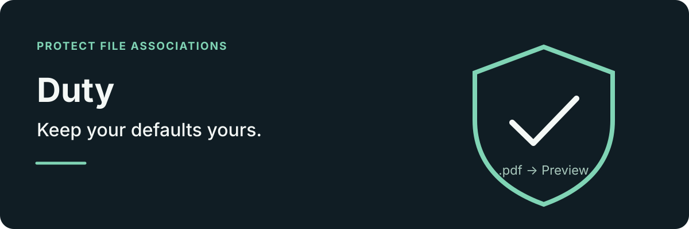

**English | [简体中文](README.zh-CN.md)**

<p align="center">
  
</p>

Keep your chosen macOS file associations in place. Duty monitors changes and restores the default app for extensions you choose, with a history of changes.

## What it does

- Monitors selected extensions and restores their chosen default apps when associations change.
- Clears a file's individual “Always Open With” override when requested.
- Includes a searchable catalog of common file types and records association changes.
- Supports launch at login and English or Simplified Chinese.

Duty watches Launch Services changes and also checks periodically. It reads the system association plist and uses system APIs to restore a changed association. Optional `duti` is used only as a fallback for resolving uncommon types.

## Install

Download `Duty.dmg` from [Releases](https://github.com/YanGN-ST/Duty/releases) and drag the app into `/Applications`, or install with Homebrew:

```sh
brew install --cask yangn-st/ygn/duty
```

Duty requires macOS 14 or later. The optional [duti](https://github.com/moretension/duti) helps identify uncommon extensions that the system cannot resolve. Install it with `brew install duti` or from the app settings when needed.

## Get started

1. Open Duty from its menu-bar shield icon.
2. Add a file type and choose its default application.
3. Turn on the lock for that extension.

Closing the window leaves protection running in the menu bar. Quit from the menu to stop it.

<details>
<summary>Build from source</summary>

```sh
git clone https://github.com/YanGN-ST/Duty.git
cd Duty
./build_app.sh
open Duty.app
```

The Swift package can also be opened in Xcode. Source code is in `Sources/Duty/`.

</details>

## License

[MIT](LICENSE)
