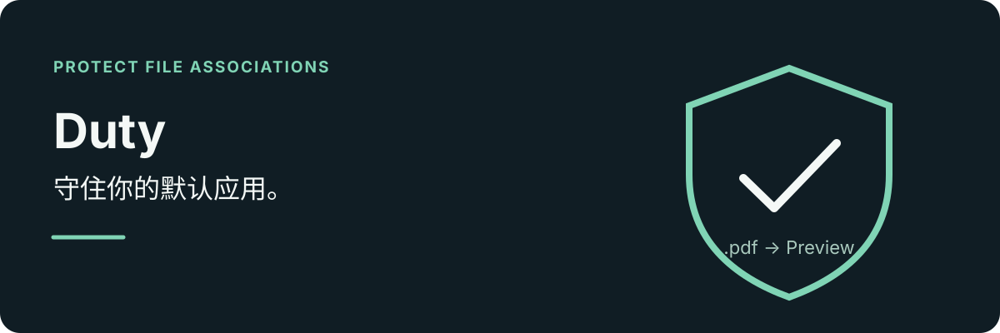

**[English](README.md) | 简体中文**

<p align="center">
  
</p>

守住你选定的默认应用。Duty 监测 macOS 文件关联，在关联被其他应用抢占时恢复你选定的应用，并可在开启历史后记录每次变化。

## 功能

- **只锁定要保护的类型**：为任意扩展名指定默认应用（`.md` → Obsidian、`.pdf` → 预览），只保护你选中的类型。
- **快速恢复**：DispatchSource 监听 Launch Services secure plist，文件一变立即检查；定时器兜底漏掉的事件。
- **清除单文件覆盖**：移除单个文件的「始终打开方式」设置，让它重新跟随系统默认。
- **不用猜扩展名**：搜索 93 个内置文件类型（中英文名称），也可以手动输入扩展名。
- **可选记录变更**：开启历史后，每次抢占与恢复都会记录时间、预期应用和检测到的应用。
- **不打扰日常使用**：只驻留菜单栏，无 Dock 图标；支持登录自启，关闭窗口后继续保护。
- **跟随你的语言**：简体中文或 English，默认跟随系统。

## 工作原理

Duty 采用「检测—恢复」方式，而不是系统级阻止。它监听 Launch Services 变化，比较当前处理程序与你的锁定项，需要时把你的选择写回去。

- **读取**：直接解析 `~/Library/Preferences/com.apple.LaunchServices/com.apple.launchservices.secure.plist`，绕开有延迟的 Launch Services 缓存；`LSCopy` API 作为回退。
- **写入**：优先调用 `NSWorkspace.setDefaultApplication(at:toOpen:)`；失败时回退到 `LSSetDefaultRole` 及处理程序 API。
- **可选 duti**：仅在 `UTType` 无法识别冷门扩展名时用于解析 UTI，不参与关联读写。

## 运行要求

- macOS 14（Sonoma）或更高版本，Apple Silicon。
- 无第三方运行时依赖，关联读写全部使用系统 Launch Services API。

## 安装

从 [Releases](https://github.com/YanGN-ST/Duty/releases) 下载 `Duty.dmg`，打开后把 Duty 拖入 `/Applications`。或使用 Homebrew：

```sh
brew install --cask yangn-st/ygn/duty
```

Duty 未经过 Apple 公证。若 macOS 阻止首次打开，请核对下载来源，再到「系统设置 → 隐私与安全性」中允许打开。

### 可选：duti

只有在 macOS 无法解析冷门扩展名时才需要 [duti](https://github.com/moretension/duti)，多数用户不需要：

```sh
brew install duti
```

如果未安装 duti 就添加未注册的扩展名，Duty 会显示安装引导；也可以稍后在「设置」的「增强组件」区域安装。

## 开始使用

1. 点击菜单栏的盾牌图标打开 Duty。
2. 添加文件类型并选择默认应用。
3. 打开该扩展名的锁定开关。
4. 用完后关闭窗口；保护会继续在菜单栏运行。

| 操作 | 行为 |
|---|---|
| 左键点击菜单栏图标 | 打开或聚焦主窗口 |
| 右键点击菜单栏图标 | 打开或退出 |
| 关闭主窗口 | 继续在后台运行 |
| 从菜单退出 | 完全停止保护 |

## 从源码构建

<details>
<summary>构建与运行</summary>

```sh
git clone https://github.com/YanGN-ST/Duty.git
cd Duty
./build_app.sh
open Duty.app
```

也可以在 Xcode 中打开 `Package.swift` 运行。源码位于 `Sources/Duty/`，内置类型数据与本地化资源位于 `Sources/Duty/Resources/`。

</details>

## 许可

[MIT](LICENSE) · [关注 YanGN 的小红书](https://www.xiaohongshu.com/user/profile/66a7e7ae000000001d023641)
